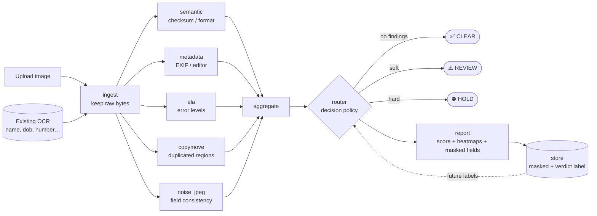

# KYC Document Tamper Detection

An AI/forensic **tamper-detection flagger** for KYC documents (Aadhaar, PAN,
Driving Licence). It sits downstream of an OCR system: OCR extracts the fields,
this module analyses the image **and** the extracted values and flags documents
that may have been edited, manipulated, or replaced — routing them to a human
reviewer with a tamper score and visual evidence.

> **Scope & honesty note.** This ships as a **human-review flagger**, not a
> certified automated decision system. With no labeled tamper data, accuracy
> cannot be certified; the system is deliberately conservative and explainable.
> See [COMPLIANCE.md](COMPLIANCE.md) before any real-data or production use.

## What it does

```
upload ─► ingest ─► detectors (parallel) ─► aggregate ─► route ─► report
                    │
                    ├─ semantic    : Aadhaar Verhoeff checksum, PAN format, DOB sanity
                    ├─ metadata    : EXIF / embedded editing-software signatures
                    ├─ ela         : Error Level Analysis heatmap
                    ├─ copymove    : duplicated-region detection
                    └─ noise_jpeg  : local noise-floor / per-field consistency
```

Output is one of three states with an indicative 0–100 score:

| Decision | Meaning |
|----------|---------|
| ✅ `CLEAR`  | No tamper indicators — auto-pass candidate |
| ⚠️ `REVIEW` | Soft anomalies — route to a human |
| ⛔ `HOLD`   | Strong indicators (e.g. checksum fail) — escalate |

### Architecture



The **router** is the single place a decision is made — swap it for a trained
classifier once labeled data exists; nothing else changes. The dashed line shows
the data-collection loop: human verdicts stored today train that classifier later.

## Quick start

```bash
python -m venv .venv && source .venv/bin/activate
pip install -r requirements.txt

# 1) make demo data (no real PII)
python scripts/make_synthetic.py mock   --out data/uploads/genuine.png
python scripts/make_synthetic.py tamper --in data/uploads/genuine.png \
                                        --out data/uploads/tampered.png

# 2a) run the demo UI
streamlit run app/streamlit_app.py

# 2b) or run the API
uvicorn api.main:app --reload   # docs at http://localhost:8000/docs

# 3) tests
pytest -q
```

### Docker

```bash
docker compose up --build      # API on :8000, UI on :8501
```

## Project layout

```
tamper/            core library (importable, UI-agnostic)
  detectors/       independent forensic detectors
  pipeline.py      orchestration entry point: analyze()
  router.py        decision policy (the ML swap-in point)
  store.py         privacy-aware result storage
app/               Streamlit demo
api/               FastAPI service
scripts/           synthetic demo-data + tampering generator
tests/             pytest suite
```

## Design notes

- **Detectors are independent** and individually testable; a deep-learning
  detector can later be added as just another module.
- **Privacy by default**: raw images and full identifiers are **not** persisted;
  only masked fields + detector outputs are stored (`tamper/config.py`).
- **The store builds your dataset**: attach a human verdict to each record
  (`store.attach_verdict`) to accumulate the labels that train the ML phase.

## Roadmap

1. Collect labeled data via the store + synthetic pairs.
2. Replace the rule-based router with a gradient-boosted classifier over
   detector features (explainable, data-efficient).
3. Add a deep-learning detector (EfficientNet/ViT) once volume allows.
